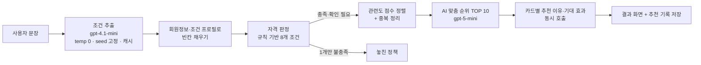

# 🧭 YouthCompass

**내 상황을 한 문장으로 적으면, 받을 수 있는 청년 정책을 AI가 골라 주는 웹 서비스**

> 예) "수원 사는 25살 대학생이에요. 연봉은 2400만원이고 월세 지원을 찾고 있어요."
> → 나이·지역·학력·소득·찾는 지원을 읽어 내고, 자격이 되는 정책 중 도움이 될 순서로 **TOP 10**을 추천

청년 정책은 4,000개가 넘고 자격 조건(나이·지역·소득·학력·취업 상태…)이 제각각이라, 나에게 맞는 정책을 직접 찾기 어렵습니다.
YouthCompass는 **자격 판정은 규칙으로 정확하게, 순위와 설명은 AI로 친절하게** 나눠서 이 문제를 풉니다.

정책 데이터는 [온통청년](https://www.youthcenter.go.kr) 청년정책 API에서 받아 옵니다.

| 항목 | 내용 |
|---|---|
| 개발 기간 | 2026.09.15 ~ 2026.11.16 |
| 인원 | 2명 |
| 저장소 | https://github.com/Choi-sung-1/YouthCompass |

---

## 👥 팀

| 이름 | GitHub | 주요 담당 |
|---|---|---|
| 최성원 | [@Choi-sung-1](https://github.com/Choi-sung-1) | 회원·보안, 온통청년 API 수집·동기화, 자격 판정·추천 로직, AI 조건 추출·맞춤 순위, 마이페이지·찜·추천 기록, 정책 목록·상세 |
| JONGSUNG2 | [@JONGSUNG2](https://github.com/JONGSUNG2) | 추천 결과 카드(요약·신청 준비·모집 규모·심사 방법), 놓친 정책·다시 확인 화면 연결, 마감일 캘린더(.ics), 정책 목록 정렬, 정책 상세·홈 화면 디자인 |

---

## ✨ 주요 기능

### AI 정책 추천 (`/policy/recommend`)
- **문장으로 조건 입력:** 문장에서 나이·사는 곳(시·도, 시·군)·학력·취업 상태·혼인·연소득·전공·지원 대상·찾는 분야를 뽑아냄
- **같은 문장 → 같은 결과:** 조건 추출은 `temperature 0` + `seed` 고정 모델을 쓰고, 같은 문장은 추출 결과를 캐시(최대 500개)
- **회원정보로 빈칸 채우기:** 문장에 없는 나이·지역은 회원정보에서, 학력·소득 등은 마이페이지 "내 조건 프로필"에서 자동으로 채우고, 어디서 가져왔는지(생년월일·가입 정보·마이페이지) 표시
- **자격 판정 → AI 맞춤 순위:** 자격 조건을 규칙으로 판정한 뒤, 통과한 정책 중 AI가 내 상황에 맞는 TOP 10을 고르고 추천 이유·기대 효과를 작성
- **중복 정리:** 해마다 다시 등록된 같은 사업이 추천 칸을 두 번 차지하지 않도록 정리 (지역은 시·군 단위로 비교)
- **조건 직접 고치기:** AI가 잘못 이해한 조건을 고쳐서 다시 추천
- **확인 필요 조건 다시 확인:** "소득은 확인 필요"처럼 판단이 안 된 조건에 답하면 그 정책만 다시 판정
- **조건 하나 차이로 놓친 정책:** 한 가지 조건만 안 맞아 빠진 정책과 그 이유
- 결과는 한 줄에 3개 카드, 요약(바로 신청 가능 / 7일 안에 마감 / 확인 필요), 신청 준비(신청 방법·제출서류 체크리스트), 찜, 마감일 캘린더 추가
- AI가 실패하면 안내 문구를 보여 주고, 조건 수정 추천은 AI 없이 조건 일치 순서로 보여 줌

### 정책 둘러보기 (`/policies`)
- 분야·지역·검색어 필터, 신청 가능만 보기, 정렬(최신 등록순 / 마감 임박순 / 최근 모집 시작순), 페이지 이동
- 정책 상세: 지원 내용·신청 방법·제출 서류, 로그인하면 **"나에게 맞을까?"** 조건별 충족 / 미충족 / 확인 필요 판정
- 마감일 캘린더 파일(.ics) 내려받기 (하루 전 알림 포함)

### 마이페이지 (`/mypage`)
- 내 활동 요약: 찜한 정책 수, 7일 안에 마감되는 찜, 추천 기록 수
- 내 조건 프로필: 시·군, 학력, 취업 상태, 혼인, 전공, 연소득 (AI 추천·상세 판정에 자동 사용)
- 찜 목록 (`/mypage/bookmarks`)
- 추천 기록 (`/mypage/history`): 그때 입력한 문장·조건·TOP 10을 AI 재호출 없이 다시 보기, 지금 정책 정보로 자격 다시 확인, 삭제

### 관리자
- 상단 바 **"정책 동기화"** 버튼 (`ROLE_ADMIN`만): 온통청년 API에서 정책 전체를 다시 받고, 새로 생기거나 바뀐 정책의 제출서류를 AI가 체크리스트로 정리
- API에서 사라진 정책은 자동으로 비활성화 (모두 정상으로 받았을 때만)
- 추천 정확도 확인용 디버그 페이지 `/api/test/recommend-debug` (`dev` 프로필 + 관리자, AI 호출 없음): 조건별로 몇 개 정책이 탈락했는지, 왜 빠졌는지 표로 확인

---

## ⚙️ 추천 동작 원리



1. **조건 추출** — 문장에서 조건과 찾는 분야·키워드를 JSON으로 뽑습니다. 결과가 흔들리면 후보와 순위가 전부 흔들리기 때문에, 이 호출만 추론 모델 대신 `temperature 0` + `seed` 고정 모델을 씁니다.
2. **빈칸 채우기** — 문장에 없는 조건은 회원정보·조건 프로필에서 채웁니다.
3. **자격 판정** — 나이·지역·학력·취업·혼인·소득·전공·특화 대상 8개 조건을 각각 `충족 / 불충족 / 확인 필요`로 판정합니다. 마감된 정책은 제외하고, 전국 대상 정책은 지역을 몰라도 충족으로 봅니다.
4. **정렬** — ① 찾는 지원과의 관련도(대분류 > 중분류 > 키워드 > 정책명 > 설명·지원 내용, 비슷한 말 포함) ② 확인 필요가 적은 순 ③ 자격 조건 일치 점수 순.
5. **AI 맞춤 순위** — 상위 후보 중 AI가 TOP 10을 고르고, 카드별 설명은 동시에 호출해 대기 시간을 줄였습니다. AI가 "맞는 정책이 없다"고 하면 억지로 채우지 않습니다.

---

## 🛠 기술 스택

| 구분 | 사용 기술 |
|---|---|
| 언어 / 런타임 | Java 17 |
| 프레임워크 | Spring Boot 4, Spring MVC, Spring Security (폼 로그인) |
| 화면 | Thymeleaf, 순수 CSS·JavaScript |
| DB | H2 (파일 DB, MySQL 모드), MyBatis |
| AI | Spring AI 2 + OpenAI (조건 추출 `gpt-4.1-mini`, 맞춤 순위·설명·서류 정리 `gpt-5-mini`) |
| 외부 데이터 | 온통청년 청년정책 API |
| 빌드 / 테스트 | Gradle, JUnit 5 |

### DB 테이블

| 테이블 | 설명 |
|---|---|
| `TBL_MEMBER` | 회원 (아이디, 암호화 비밀번호, 생년월일, 지역, 권한) |
| `TBL_MEMBER_PROFILE` | 내 조건 프로필 (시·군, 학력, 취업, 혼인, 전공, 연소득) |
| `TBL_POLICY` | 온통청년 정책 (자격 조건, 신청 기간, AI 정리 제출서류 등) |
| `TBL_BOOKMARK` | 찜 |
| `TBL_RECOMMEND_HISTORY`, `TBL_RECOMMEND_ITEM` | 추천 기록과 그때의 TOP 10 |
| `TBL_RECOMMEND_FEEDBACK`, `TBL_SYNC_LOG` | 추천 피드백, 동기화 기록 (확장용으로 정의만 해 둠) |

---

## 🚀 실행 방법

### 1. 설정 파일 만들기
설정 파일 두 개는 비밀번호·API 키가 들어가서 Git에 올리지 않습니다 (`.gitignore`). 예시 파일을 복사해서 만듭니다.

```bash
cd src/main/resources
cp application-example.properties application.properties
cp application-secret-example.properties application-secret.properties
```

`application-secret.properties`에 키를 채웁니다.

```properties
# 온통청년 청년정책 API
policy.api.base-url=https://www.youthcenter.go.kr
policy.api.key=발급받은_온통청년_API_키

# OpenAI
spring.ai.openai.api-key=발급받은_OpenAI_API_키
```

DB 파일 위치는 `application.properties`의 `spring.datasource.url`에서 바꿀 수 있습니다 (기본값: 프로젝트 폴더의 `db/`).

### 2. 처음 한 번: 테이블 만들기
`application.properties`에서 아래 값을 `always`로 바꾸고 한 번 실행한 뒤, 다시 `never`로 돌려 둡니다.
(`always`로 두면 실행할 때마다 `schema.sql`이 다시 돌아갑니다.)

```properties
spring.sql.init.mode=always
```

### 3. 실행

```bash
./gradlew bootRun
```

→ http://localhost:8080

### 4. 처음 한 번: 정책 데이터 받기
1. 회원가입
2. 서버를 끄고, DB 도구(IntelliJ Database 창, DBeaver 등)로 `application.properties`의 `spring.datasource.url` 주소(사용자 `sa`, 비밀번호 없음)에 접속해서 내 계정을 관리자로 바꾸기
   ```sql
   UPDATE TBL_MEMBER SET MEMBER_ROLE = 'ROLE_ADMIN' WHERE MEMBER_LOGIN_ID = '내아이디';
   ```
   (H2 파일 DB는 한 번에 한 프로그램만 열 수 있어서 서버를 끄고 접속합니다. `/h2-console`은 보안 설정 때문에 열리지 않습니다.)
3. 서버를 다시 켜고 로그인하면 상단 바에 생기는 **"정책 동기화"** 버튼 누르기 (정책 약 4,000개, 1분 안팎)

---

## 🧪 테스트

```bash
./gradlew test     # 평소 테스트 (AI 호출 없음)
./gradlew aiTest   # 실제 OpenAI를 호출하는 테스트 (@Tag("ai"), 비용 발생)
```

자격 판정(나이·지역·소득), 놓친 정책 찾기, 다시 판정, 중복 정리, 분야·키워드 매칭, API 응답 변환, 찜·추천 기록 Mapper/Service 등을 테스트합니다.
`aiTest`의 `ExtractionAccuracyTest`는 예시 문장으로 조건 추출 정확도를 확인합니다.

---

## 📁 프로젝트 구조

```
src/main/java/com/app/YouthCompass
├── config          보안 설정(SecurityConfig), 모든 화면 공통 모델(로그인 정보)
├── home            홈 화면 (정책 수, 마감 임박, 최근 모집 시작)
├── member          회원가입·로그인 (Spring Security)
├── profile         마이페이지, 내 조건 프로필
├── bookmark        찜
├── history         추천 기록 저장·조회·삭제
├── openAI          문장 → 조건 추출 (OpenAI)
└── policy          추천·목록·상세·다시 판정·캘린더·관리자 컨트롤러
    ├── domain
    │   ├── eligibility     자격 조건 모델 (지역, 학력, 취업, 혼인, 소득, 전공, 특화 대상, 시·군 목록)
    │   ├── recommendation  찾는 분야·키워드 (PolicySearchIntent, PolicyCategories, PolicyKeywords)
    │   └── model           정책 VO, 원문 정리(PolicyText)
    ├── eligibility     자격 판정, 놓친 정책 찾기, 확인 필요 조건 다시 판정
    ├── recommendation  추천 흐름, AI 맞춤 순위·추천 이유, 회원정보로 빈칸 채우기
    ├── external        온통청년 API 호출·변환·동기화, 제출서류 AI 정리
    └── dto             화면용 데이터

src/main/resources
├── templates       Thymeleaf 화면 (fragments/ 는 여러 화면이 같이 쓰는 조각)
├── static          css/common.css(공통), css/policy-card.css(추천 카드), js/(찜, 다시 확인)
├── mapper          MyBatis SQL
├── schema.sql      테이블 정의
└── sigungu.csv     시·군 코드 목록
```

### 화면 주소

| 주소 | 화면 | 로그인 |
|---|---|---|
| `/` | 홈 | - |
| `/policies` | 정책 목록 | - |
| `/policies/{id}` | 정책 상세 | - (로그인하면 조건 판정) |
| `/policy/{id}/calendar.ics` | 마감일 캘린더 파일 | - |
| `/policy/recommend` | AI 정책 추천 | 필요 |
| `/mypage` | 마이페이지 | 필요 |
| `/mypage/bookmarks` | 찜 목록 | 필요 |
| `/mypage/history` | 추천 기록 | 필요 |
| `/member/join`, `/member/login` | 회원가입, 로그인 | - |
| `/admin/policies/sync`, `/admin/policies/documents` | 정책 동기화, 제출서류 AI 정리 (POST) | 관리자 |

---

## 🔧 고민한 점 · 트러블슈팅

| 문제 | 해결 |
|---|---|
| 같은 문장을 넣어도 추천이 매번 달라짐 | 추론 모델은 temperature를 바꿀 수 없어서, 조건 추출만 `gpt-4.1-mini` + `temperature 0` + `seed` 고정으로 분리하고 결과를 캐시 |
| AI 추천 대기 시간이 1분 이상 | 순위 1회 호출 + 카드별 설명 동시 호출로 나누고, 순위 입력을 줄이고, 설명 호출의 추론 강도를 낮춤 |
| "대학생이에요"처럼 신분만 말해도 AI가 찾는 분야를 추측 | 프롬프트 규칙 + 추출된 키워드가 문장에 실제로 있는지 검증해서 추측한 분야는 버림 |
| 같은 사업이 해마다 다시 등록돼 추천 칸을 두 번 차지 | 정책명·지역으로 중복을 정리. 행정구역 개편으로 지역 코드가 달라도 같게 보도록 시·군 단위로 비교 |
| 같은 분야 정책이 모두 동점이라 엉뚱한 정책이 앞에 옴 | 관련도 점수에 정책 설명·지원 내용(비슷한 말 포함) 키워드 일치를 가장 약한 근거로 추가 |
| AI가 맞는 정책이 없다고 했는데 규칙 기반 후보로 채워짐 | AI 판단을 존중해 억지로 채우지 않도록 변경 |
| 공공데이터의 빈 값·`해당없음`·`http` 없는 링크 | 의미 없는 값은 저장·표시하지 않고, `www.xxx.kr` 같은 링크엔 `https://`를 붙여 "신청하러 가기"가 우리 사이트로 열리지 않게 함 |
| 프롬프트에 들어간 사용자 문장의 `{ }` 때문에 템플릿 오류 | 사용자 문장의 중괄호를 소괄호로 바꿔서 전달 |

---

## 📌 참고

- 공공데이터 원문의 빈 값·`해당없음`·`-`는 화면에 보여 주지 않고, `www.xxx.kr`처럼 `http`가 없는 링크는 `https://`를 붙여서 씁니다.
- 날짜(D-day, 마감 여부)는 한국 시간 기준입니다. 서버는 한국 시간대(`Asia/Seoul`)로 실행하는 것을 권장합니다.
- 정책 정보의 출처는 온통청년이며, 실제 신청 자격은 각 정책의 공고문으로 다시 확인해야 합니다.
